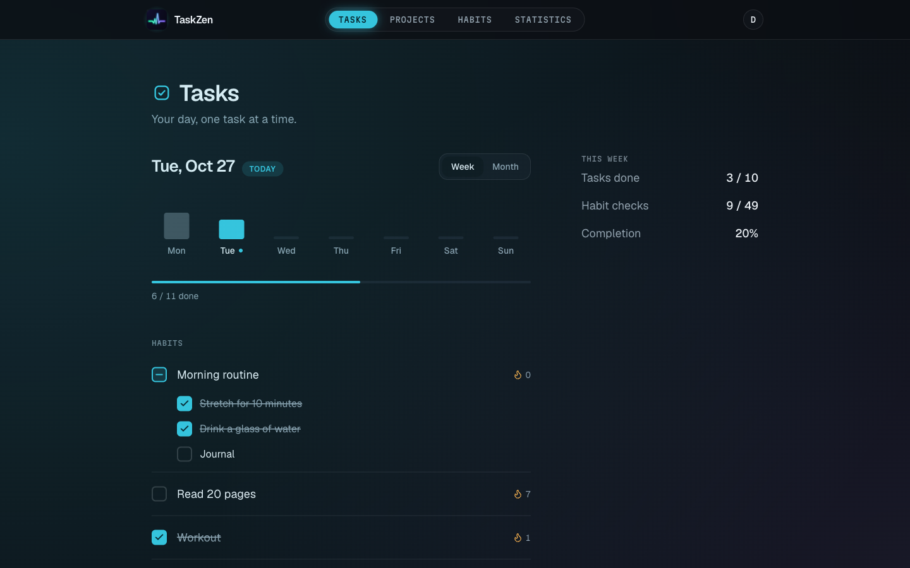
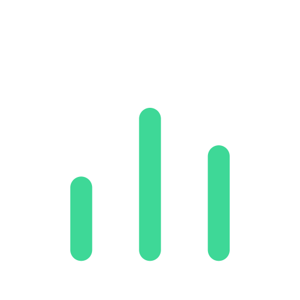
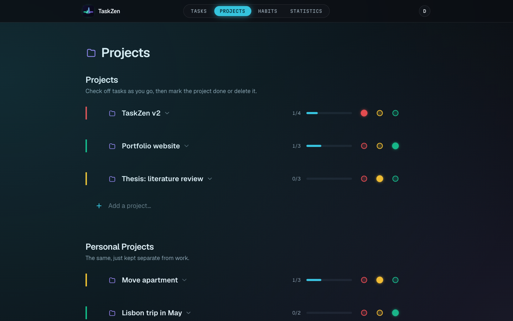
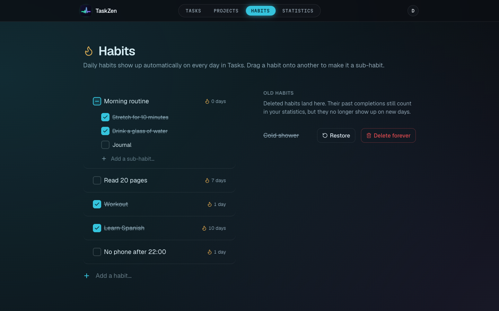
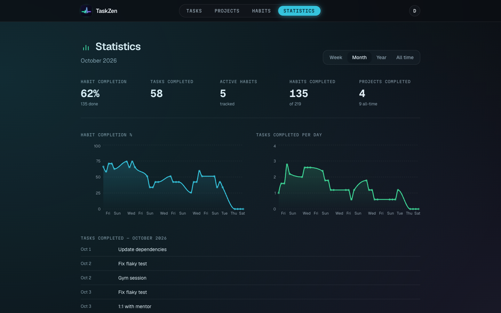
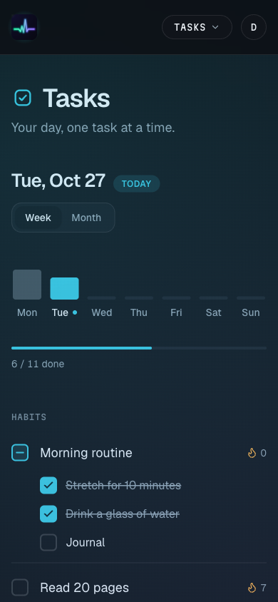
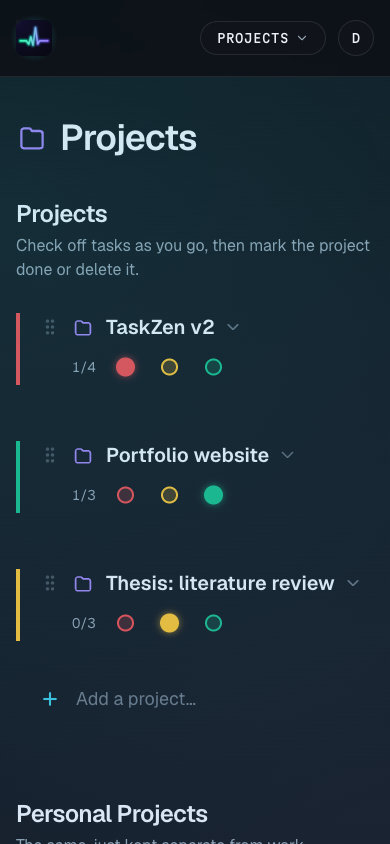
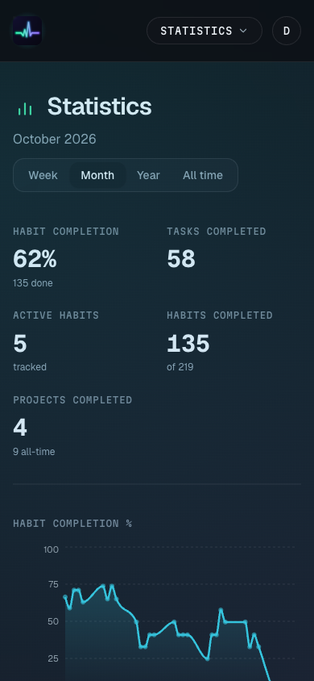
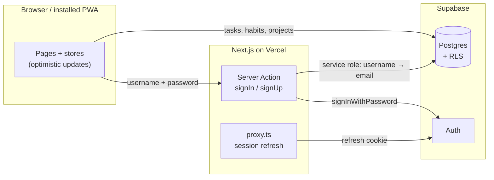

<p align="center">
  
</p>

<h1 align="center">TaskZen</h1>

<p align="center">
  Today's tasks, long-running projects and daily habits in one calm, installable app.
</p>

<p align="center">
  <a href="https://taskzen-demo.vercel.app"></a>
</p>

<p align="center">
  
  
  
  
  
  
  
</p>

<br>

<p align="center">
  
</p>

> [!NOTE]
> The demo needs no account. It opens with a few weeks of sample data, and everything you change is saved in your own browser only. Reset it anytime from the account menu in the top right.

## What's inside

<table>
  <tr>
    <td width="50%" valign="top">
      <br>
      <b>Tasks</b><br>
      A list per day with a week or month strip that shows how each day went. Your daily habits appear on every day next to the tasks, so the whole day is on one screen.
    </td>
    <td width="50%" valign="top">
      <br>
      <b>Projects</b><br>
      Work and personal projects, each with its own subtasks and a red, yellow or green status. Drag to reorder or move a project between sections. Finished items clear themselves after 24 hours.
    </td>
  </tr>
  <tr>
    <td width="50%" valign="top">
      <br>
      <b>Habits</b><br>
      Streaks for every habit, and sub-habits: drag one habit onto another to group it, and the parent counts as done once all of its children are. Archived habits keep their history.
    </td>
    <td width="50%" valign="top">
      <br>
      <b>Statistics</b><br>
      Habit completion and tasks done per day for the week, month, year or all time, plus a permanent log of finished projects.
    </td>
  </tr>
</table>

It also installs as an app on phone or desktop (PWA), and you sign in with a username instead of an email address.

## Screenshots

<table>
  <tr>
    <td width="50%"></td>
    <td width="50%"></td>
  </tr>
  <tr>
    <td colspan="2"></td>
  </tr>
</table>

<p align="center">
  
  &nbsp;
  
  &nbsp;
  
</p>

## How it works

There is no separate backend. The browser talks to Supabase directly, and Postgres Row Level Security decides what each user can read and write. Only login needs elevated rights, so it runs as a Next.js Server Action.



- **Optimistic UI.** Ticking, editing, reordering and deleting update the screen first and are written to Supabase in the background. If a write fails, the change is rolled back.
- **Username login.** A `profiles` table maps usernames to accounts. The server looks up the email with the service-role key, which never reaches the browser, and then signs in through Supabase Auth.
- **Demo mode.** With `NEXT_PUBLIC_DEMO_MODE=1` the Supabase client is swapped for a small in-browser implementation backed by `localStorage` ([`src/lib/demo`](src/lib/demo)), seeded with sample data relative to today. Auth is skipped and no keys are needed, which is how the [live demo](https://taskzen-demo.vercel.app) runs.

## Tech stack

| Layer | Tools |
|---|---|
| Framework | Next.js 16 (App Router, Turbopack), React 19, TypeScript |
| Styling | Tailwind CSS 4, Base UI, lucide-react, Geist and Martian Mono |
| Interaction | dnd-kit for drag and drop, Recharts for charts |
| Data and auth | Supabase Postgres with Row Level Security, Supabase Auth via `@supabase/ssr` |
| Hosting | Vercel, with a custom service worker for the installable PWA |

## Getting started

1. Install dependencies and create your env file:

   ```bash
   npm install
   cp .env.local.example .env.local
   ```

2. Fill in `.env.local` from your Supabase project (Settings → API):

   | Variable | Used for |
   |---|---|
   | `NEXT_PUBLIC_SUPABASE_URL` | Supabase project URL |
   | `NEXT_PUBLIC_SUPABASE_ANON_KEY` | Browser access, limited by RLS |
   | `SUPABASE_SERVICE_ROLE_KEY` | Server-only: username lookup at login and profile creation at sign-up |

3. Run [`supabase/schema.sql`](supabase/schema.sql) in the Supabase SQL Editor. It creates every table and RLS policy.

4. Start the dev server and open [localhost:3102](http://localhost:3102):

   ```bash
   npm run dev
   ```

To try the app without Supabase, skip steps 2 and 3 and start it in demo mode:

```bash
NEXT_PUBLIC_DEMO_MODE=1 npm run dev
```

| Command | What it does |
|---|---|
| `npm run dev` | Dev server on port 3102 |
| `npm run build` | Production build |
| `npm run start` | Serve the production build |
| `npm run lint` | ESLint |

## Project structure

```
src/
  app/
    page.tsx               Redirects to /tasks
    tasks/                 Tasks, Projects, Habits and Statistics pages
    login/, register/      Username-based auth pages
    manifest.ts            PWA manifest
  components/
    site-header.tsx        Logo, page tabs and account menu
    site-nav-tabs.tsx      Sliding pill tabs on desktop, dropdown on mobile
    account-menu.tsx       Username and sign out (reset in the demo)
    app-splash.tsx         Splash screen until the session check resolves
    tasks/                 Checkbox, criticality picker, inline inputs, view tabs
  lib/
    tasks/store.ts         Tasks and habits state, synced with Supabase
    tasks/projects-store.ts  Projects state, drag-and-drop order, 24h cleanup
    auth/actions.ts        signIn, signUp and signOut server actions
    supabase/              Browser, server and service-role clients
    demo/                  Demo mode: in-browser client and sample data
  proxy.ts                 Session refresh and login redirect (Next.js 16's middleware)
supabase/schema.sql        Tables and RLS policies
public/sw.js               Service worker
```

## License

[GPL-3.0](LICENSE)
